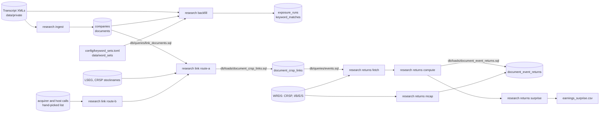

# The pipeline

Each step reads files or tables and writes files or tables. Steps run by hand, in this
order; nothing schedules them. Run any step with `uv run research <step> --help`.

| Step | Command | Reads | Writes | How the DB table was last filled |
|---|---|---|---|---|
| Store | `research transcripts load`, then `verify` | the vendor zips | `transcript_files` | `research transcripts load` on the six vendor zips (2002–2024), 2026-11-11; `verify` passed |
| Parse | `research ingest` | transcript XMLs | `companies`, `documents` | Oct 2026 migration from Supabase, plus fixes in `db/fixes/` |
| Match | `research backfill` | XMLs, `documents`, word lists | `exposure_runs`, `keyword_matches` | `research backfill`, 2026-10-17 (before the Q&A parser fix) |
| Link | `research link route-b`, then `route-a` | route B: a list of calls on acquirer and broker-host company rows (see below); route A: the `db/queries/link_documents.sql` export, LSEG, CRSP stocknames | `proposed_links_all.csv` | loaded with `db/loads/document_crsp_links.sql` |
| Returns | `research returns fetch`, `compute` | `db/queries/events.sql` export, WRDS | `event_returns.csv.gz` | loaded with `db/loads/document_event_returns.sql` |
| Size | `research returns mcap` | `event_returns.csv.gz`, WRDS | `mcap_pre.csv` | the same load script |
| Surprise | `research returns surprise` | `event_returns.csv.gz`, WRDS | `earnings_surprise.csv` | not in the DB |

Route B is only for company rows named after a later owner or a conference host,
whose calls are about other companies. Its `--calls` file (document_id, company_id,
company_name, call_date, event_title) was picked by hand on 2026-10-17, after the
company cleanup, and no saved query reproduces it. Do not pass it every document: route A
treats each document in `--route-b` as already linked and skips it.

## Database tables

| Table | Rows | One row per |
|---|---|---|
| `companies` | ~19k | company name and RIC as the vendor files it |
| `documents` | ~507k | transcript: metadata, word and sentence counts, readability, sentiment |
| `keyword_sets` | 2 | word list run against the corpus (`risk`, `activeness`) |
| `exposure_runs` | ~1.0M | (document, keyword set): counts of matches and sentences |
| `keyword_matches` | ~50.6M | keyword hit, with the matched sentence; about 98% of the DB |
| `document_crsp_links` | ~352k | call linked to a CRSP security on the call date |
| `document_event_returns` | ~352k | linked call: day 0, window returns, market-model fit, `mcap_pre` |

| `transcript_files` | ~635k | raw vendor XML file revision, 2002–2024 (see below); 15 GB |

Two more tables, `company_cleanup_20261017` and `sentiment_recompute_20261017`, are audit
records of the October 2026 fixes in `db/fixes/`.

### `transcript_files`: the raw XMLs

A working copy of the vendor files, so recomputes and checks need no files on disk. The
zips stay the record of truth; the table can be rebuilt from them.

- **One row per file revision.** The vendor re-issues a call under the same file name
  with a later `lastUpdate` stamp: 17,481 calls have two or more revisions. Every
  revision is kept. A byte-identical second copy is not.
- **Everything the vendor sent is stored**, including stubs, files that are not
  well-formed XML, briefs (`story_type = 'brief'`, named `<id>_B.xml`) and the empty
  stubs that withdraw a call (`story_action = 'delete'`). Only macOS resource files,
  empty files and files that are not valid UTF-8 are left out.
- **What it holds:** 635,490 revisions of 617,821 file names. 459 are withdrawal stubs
  (440 calls exist only as a stub), 24 are briefs and 185 are marked Preliminary.
  109,908 calls in the view have no `documents` row yet: the 2022–2024 calls and about
  2,000 older ones that were never ingested.
- **`transcript_files_latest`** is the view to read: one row per call, the latest
  published transcript by `last_update` (ties go to the later year folder, then to the
  hash). `withdrawn_at` is set when the vendor pulled the call after that revision;
  nothing is excluded for it.
- **Append-only.** The pipeline and agent logins can insert and read. Only `postgres`
  can update or delete.
- **Name a revision by its `sha256`, not its `id`.** The hash is the same however the
  table is restored or rebuilt from the zips; the `id` is not guaranteed to be.
- **Backed up once per load**, not nightly (see `db/README.md`).
- `sha256` is the hash of the original file, and the stored text reproduces the file
  byte for byte. `research transcripts verify` checks both against the zips.

## Where the numbers come from

- `documents.num_words`, `num_sentences` and readability: the spoken text, that is the
  Presentation and Q&A with speaker lines removed
  (`research.pipelines.ingest.analyze_document`, text from
  `research.transcripts.parse.spoken_text`). Rows stored before 2026-11-11 used the whole
  XML body and are not recomputed yet (see [known_issues.md](known_issues.md)).
- `documents.sentiment`: a financial-news DistilRoBERTa model scores each sentence
  (+score positive, −score negative, 0 neutral); that is averaged within each paragraph,
  then across paragraphs.
- `lm_score`, `hiv4_score`: per sentence, positive minus negative word counts from the
  Loughran–McDonald and Harvard IV dictionaries (pysentiment2), summed over the call.
- `ml_score`: per sentence, +1 for every adjacent word pair where both words are on the
  Garcia positive unigram list and −1 where both are on the negative list, summed.
  These three are sums, so they grow with call length.
- `exposure_runs`, `keyword_matches`: Presentation and Q&A text only
  (`research.transcripts.parse.load_document`), direct matching.

## Rerunning a step

- New transcripts: `research ingest`, then `research backfill` for every keyword set.
- A new keyword set: add it to `config/keyword_sets.toml` and a `keyword_sets` row (with
  `total_keywords`), then `research backfill`. Don't change the options of a set that
  already has runs; add a new set.
- New links or returns: run the step, then the matching `db/loads/` script. Both load
  scripts expect empty tables; replacing rows is a DB change that needs approval.
